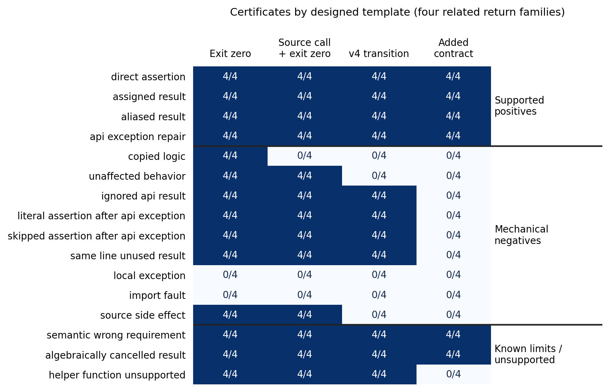
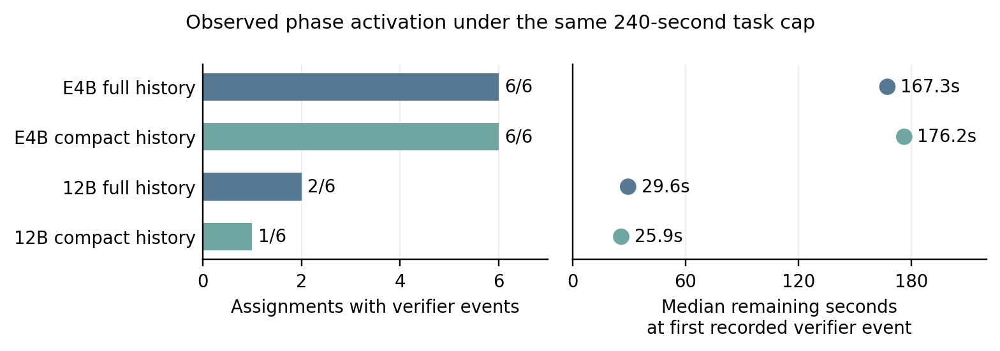

# BEAR: When Passing Checks Do Not Verify Repository Repairs

**An executable evidence contract and budget audit for small Gemma 4 agents**

## Abstract

A repair agent can pass its own check without checking its repair. A passing agent-generated test can call real code while never asserting its result, or assert a literal while ignoring that result. We study this gap between execution and verification in Gemma 4 repository repair. BEAR records source provenance, frozen check identity, starting-to-current behavior, assertion execution, and a partial syntactic result link. In a registered 64-case designed conformance study, the added contract preserves 16/16 supported positive checks and rejects all 36 explicit mechanical negatives; a source-bound fail-to-pass comparator certifies 16 of those negatives. The contract still certifies eight known semantic and dataflow counterexamples and abstains on four valid helper-based checks. These are diagnostic cases, not repaired issues. Retrospective replay of all ten original helper invocations gives zero supported checks and identical judgments under both comparators. Real-agent evidence remains mixed: nine architecture rounds reuse six issues, and a 12B compact-history workflow accepts 3/6 patches versus 2/6 for fixed, with verification observed only once. The supported contribution is a testable, explicitly limited evidence contract; general repair superiority and a calibrated compute policy remain unestablished.

## 1. Introduction

Executing repository code, checking the required behavior, and repairing the issue are different achievements. A tool trace can establish the first while leaving the others unresolved. Under a fixed deadline, an extra verifier also consumes time that could have produced a useful patch. The central question is therefore what evidence each additional action actually buys.

Repository repair demands both a useful implementation change and credible evidence about it. Test-based repair has employed tests to guide search since at least 2009 [14]. The oracle problem—whether a test encodes correct requirements—has been extensively surveyed [11]. Generate-and-validate systems face overfitting to incomplete test suites [12, 13]: a patch can pass available tests while introducing new defects or failing to address the actual issue. These problems persist when the generator is a reasoning agent [15] rather than genetic programming.

The Gemma 4 competition evaluates independent patch tests under a shared 12-hour allowance [1]. Our initial Budgeted Evidence Acquisition and Repairability-Aware Reasoning prototype recommended actions with disclosed priority and cost heuristics. Its pilot never invoked the adviser. Subsequent experiments repeatedly separated configured mechanisms from correctly executed mechanisms, and executed checks from relevant behavioral evidence.

We ask: which mechanical observations justify calling a check informative? What does a lightweight executable contract catch and miss? Do delivered workflows improve externally tested repair under equal budgets? Our contribution is an auditable diagnostic resource with counterexamples, accompanied by transparent negative and exploratory repair results. It is not a claim that ordinary assertion analysis or a new agent acronym solves the oracle problem.

## 2. Related Work

SWE-bench establishes repository-level patch evaluation [3], and SWE-agent studies agent–computer interfaces [4]. Agentless combines localization, reproduction tests, and patch validation [5]. SWT-Bench evaluates original-to-fixed tests and uses them to filter repairs [6]; AssertFlip generates reproductions by inverting passing tests [7].

Assertion dependence is also established. OraclePolish uses dynamic tainting to identify brittle assertions and unused test inputs [8]. BlindSpotEval studies behavioral obligations beyond coverage and mutation [9]. A recent SWT-Bench taxonomy includes mechanical failures, disconnected checks, and misunderstood requirements [10].

These agent workflows inherit a longstanding validation problem. Qi et al. identify exit-code proxies that accept patches without checking their outputs [12]; Smith et al. examine repair overfitting [13]. ReAct interleaves reasoning and action [15], but an observation still requires an adequate oracle [11]. BEAR examines this distinction inside a constrained agent workflow; these predecessors are conceptual context, not experimentally evaluated baselines.

We do not claim a new taxonomy, general slicer, test-generation algorithm, or optimal budget rule. Our narrower contribution connects source-version provenance and a partial assertion contract to observed small-agent execution, while retaining counterexamples and independent repair outcomes. BEAR serves as an executable measurement bridge between delivered workflow, actual source and assert execution, test relevance, and external patch outcomes.

## 3. Evidence Contract and Resource

**Keep the endpoint independent.** A diagnostic record never receives reference fixes or external acceptance labels. External tests determine repair acceptance. Before evaluating an agent, empty and reference controls and import-origin probes qualify the local environment: the empty patch must fail, the reference must pass, and tests must load workspace source. This checks executable discrimination, not complete oracle fidelity.

**Define observable obligations.** For a frozen Python check, the certificate requires source stability during execution; observed calls into repository functions; valid current execution; a witness-assertion or repository-API failure on fresh starting source; and an executed, nonliteral assertion with a syntactic backward path to a recorded source call. Identical check bytes run on current source and a fresh HEAD extraction. Repository bytes compile directly to avoid stale bytecode after same-size, same-timestamp edits.

```text
freeze check bytes and fingerprint source
execute current and fresh starting source in subprocesses
retain source-call origins, assertion events and child faults
trace assertion expressions backward through straight-line assignments
if transition, freshness and supported linkage hold: record certificate
otherwise: record the failed or unproven obligation
always leave semantic relevance unassessed
```

The backward slice supports straight-line imports, name assignments and aliases, and explicit assertions. Definition order prevents a later overwrite from changing an earlier alias's provenance. Helpers, branches, loops, mutation forms, and reflection trigger abstention. The implementation observes call lines rather than full dynamic dataflow; several calls on one line can be conflated. The certificate is a partial syntactic and execution observation, not causal proof.

**Make failure inspectable.** An ignored API return followed by `assert 1 == 1` can pass after repairing an unrelated exception. Likewise, an assertion in an unexecuted branch supplies no executed obligation. These differ from import faults, copied logic, unchanged behavior, and source-changing checks. Each is an executable example rather than an inferred repair success.

**Leave semantics separate.** `x - x == 0` can depend syntactically on `x` without constraining it. A genuine fail-to-pass assertion can also encode the wrong requirement. Executions alone cannot distinguish different intended specifications that give the diagnostic identical inputs. This is the established oracle problem [11]; issue relevance remains an independent review and test obligation.

The prepared `bearcheck` package supplies `diagnose(repository, check, state)`, a CLI, a versioned JSON schema, SHA256 implementation identities, Apache-2.0 licensing, and citation metadata. Python 3.10+ and Git suffice; no model, credentials, or official data is required. Ledger state stays outside the source tree. Checks run with ordinary sandbox permissions and may have side effects; the tool provides neither isolation nor rollback. Each child has an eight-second timeout. A zero CLI exit means a record was emitted, not that a patch is correct.

## 4. Experimental Protocol

**Designed diagnostic comparison.** Before execution, we register four typed-return families crossed with sixteen templates: 64 related fixtures. Compare exit zero, source-call-plus-exit-zero, frozen v4 source-bound fail-to-pass, and the added assertion contract. Report every template, including semantic counterexamples and unsupported valid checks. These cases measure specified conformance; they are not held-out projects, independent observations, or an accuracy and prevalence estimate. No significance claim is inferred from their counts.

**Retrospective real-check replay.** Register every original source-witness helper invocation: ten calls, four reused issues, and eight unique scripts. Reconstruct source from frozen snapshots and successful native edits preceding each check; do not replay recorded shell commands. Run both frozen v4 and the added contract in the qualified CPU environment without reference fixes or acceptance labels. Shapes were already inspected, so this is exposed development data, not an independent check benchmark.

**Real repair evaluation.** Public data contain 67 FastAPI, 48 Rich, 13 Requests, and one HTTPX issue. The original six pilot issues become development data. Nine completed architecture rounds reuse those issues; 162 assignments are not 162 independent tasks. Main rounds use a single base per submission, no LoRA, seed 42, temperature 0.2, 240 seconds, and 40 configured native operations. Two labeled smoke rounds use 120 seconds. Compare architectures within model; model changes are not architecture gains. The official-prompt control adapts the provided prompt and tools, not the full optional-adapter or analyzer starter.

Sources, actual model-request schemas, sampling, environments, and built agents are hash-bound. Codex manually reviews raw patches, traces, and independent tests; this is not independent human annotation. Agent-induced syntax and import failures count as rejections. Zero-model-call infrastructure failures remain separate. Protected-test modifications are stripped before scoring and retained as violations. Native commands can bypass helpers, so all assigned trajectories remain in the endpoint, regardless of activation.

A strict complete development advantage selects 12B compact history before a prospective 23-issue cohort begins. Four frozen policies yield 92 assignments across two predefined shards; compact minus fixed is primary. Report the entire cohort with paired differences, costs, repository sensitivity, bootstrap intervals, and exact McNemar counts. At this snapshot the cohort remains in progress; no shard result enters the paper. A separately registered assertion-contract model experiment has passed CPU compilation and transport checks but has no completed repair result.

## 5. Completed Results

**Diagnostic comparison.** The added contract closes specified mechanical gaps without eliminating the oracle problem.

| Designed category | Cases | Exit 0 | Call + 0 | v4 | Contract |
| --- | ---: | ---: | ---: | ---: | ---: |
| Supported positives | 16 | 16 | 16 | 16 | 16 |
| Mechanical negatives | 36 | 28 | 24 | 16 | 0 |
| Known limits / unsupported | 12 | 12 | 12 | 12 | 8 |

The last row is essential: four wrong-requirement and four cancellation variants still certify. Four valid helper-based checks abstain. Thus 0/36 is designed negative conformance, not universal soundness or 100% general diagnostic accuracy. All sixteen template-level decisions and four-family variants are retained in the resource.



Local median whole-check cost is 0.218 seconds for v4 and 0.230 for the added contract; a separate CPU environment measures 0.236 and 0.235 seconds. These host-dependent measurements establish neither zero overhead nor improved agent throughput. Independent extraction and private Kaggle CPU execution reproduce all 64 decisions, source and plan identities, seven diagnostic tests, and the generic demo without model calls. One Requests integration replay using an existing agent patch retains copied, unaffected, and defect-sensitive distinctions; it is not another repaired issue.

**Real-check coverage failure.** The retrospective replay supports 0/10 script shapes, observes 0/10 assertion-result links, and issues 0/10 certificates. Functions, classes, and control flow exceed the partial slicer. Both comparators return identical outer judgments: two execution failures, seven still-failing behaviors, and one undemonstrated sensitivity; each has one invalid, eight failing, and one passing child on both source versions. Only one invocation follows a successful source edit. Both have zero timeouts after the shared tracing correction, which cannot be credited to the assertion contract. No added real diagnostic benefit is demonstrated; designed conformance alone would conceal this applicability failure.

**Repair outcomes and nonactivation.** Selected same-model results are below. Complete nine-round counts remain in the companion, including failed interface and diagnostic smoke directions.

| Direction | Base | External acceptance on six reused issues |
| --- | --- | --- |
| Native interface | E4B | fixed 2; official 1; command 1 |
| Guarded runtime | E4B | fixed 1; official 1; guarded 0 |
| Guarded runtime | 12B | fixed 3; official 3; guarded 0 |
| Staged verification | E4B | fixed/official/history/compact 1 each |
| Staged verification | 12B | fixed 2; official 1; history 2; compact 3 |
| Source witnesses, original slow helper | 12B | fixed/official/current 3 each; paired 2 |

Valid recorded tool schemas do not prevent E4B from calling nonexistent Skill names. The later E4B guarded direction skips installation in 6/6 assignments. With 12B, installation and 37 runtime operations execute, but acceptance remains 0/6. Two always-truthy tuple edits are blocked; this is a guard observation, not repair benefit.

The compact 12B margin is one issue: +16.7 percentage points, exploratory paired-bootstrap interval [0, 50] points, exact McNemar p=1. Other 12B rounds accept 3/6 fixed patches, exposing between-round variation despite the seed. Compact verification activates in 1/6 assignments and history verification in 2/6; most accepted drafts are captured by harness fallback. One accepted compact trajectory edits protected tests; independent scoring removes those edits before accepting its source change. Neither fact is hidden.

**Observed phase budget.** E4B reaches both phases in every candidate assignment; 12B rarely reaches verification. At the first recorded verifier event, median remaining time is 176.2 and 167.3 seconds for E4B compact and history but 25.9 and 29.6 for 12B. This event follows the verifier's first completed response, not its exact phase start. Missing verifier events coincide with session timeouts in three assignments per 12B candidate. These observations suggest a budget bottleneck without identifying its cause or establishing a model-comparison effect.



The original source-witness round installs both modes on all six issues but records nine current-child timeouts and one invalid check across ten invocations; its paired invocation also times out on HEAD. Outer labels mask those faults. A later helper correction reduces import-tracing overhead in CPU fixtures; it never replaces the frozen model results. A FastAPI check can show a source-sensitive transition while its patch fails external tests, directly illustrating the relevance boundary.

**Representation and scoring provenance.** Issue-only graph-module BM25 hits a reference-changed source module at rank ten for 85/129 tasks; this is not causal localization. Two specified snapshots have exact graph IDs for 798/809 synchronous definitions and 0/139 asynchronous definitions, although enclosing node text may contain async bodies. Resolve source when exact graph lookup fails.

Initial local Requests empty patches appear accepted while importing an installed package because the subprocess route misses `src`. A shared source-first adapter repairs that route; this does not establish an official Docker-scorer defect. Identical controls then qualify 98/129 tasks: 52 FastAPI, 36 Rich, nine Requests, and one HTTPX. Remaining tasks have unavailable verification (17), unverified reference controls (12), or already-passing empty patches (2). Qualification is not model repair rate.

## 6. Limitations and Reuse

The designed templates establish conformance within a declared fragment, not broad diagnostic accuracy. Real checks expose its coverage failure. Independently collected checks and stronger slicing and mutation baselines are needed; extending support after inspecting these scripts would require fresh evaluation. The original priority and cost heuristic is neither a learned repairability estimator nor a calibrated expected-value policy.

Repair search is exploratory, single-seed, and concentrated on six reused issues. Repository histories induce dependence; issue bootstrap intervals can understate uncertainty. Complete new-issue results are needed before a superiority claim, and activation-matched ablations before mechanism attribution. Prompt instructions do not enforce per-phase budget reserves.

The companion recomputes nine-round arithmetic and execution aggregates from content-limited records, and reruns generic diagnostic fixtures from source. Derived real-check summaries reproduce all ten judgments and zero coverage; private check bodies remain excluded. It neither independently annotates traces nor reruns models. No official issues, reference patches, hidden tests, repositories, or weights are redistributed. Materials remain private review artifacts; public release, external adoption, and formal Writeup submission are separate, outstanding steps.

## 7. Conclusion

A passing check becomes useful evidence only when its connection to the repair can be examined. BEAR makes part of that connection executable: source identity, version transition, assertion execution, and a limited result link. The same evaluation exposes its boundary: all 36 designed mechanical negatives are rejected, yet no original real check falls within the supported fragment. Neither finding substitutes for accepted repairs.

The reusable contribution is a contract, counterexamples, and an audit trail that lets researchers distinguish tool delivery from execution and execution from useful verification. For small coding agents, the next advance must establish both applicability and independently measured repair benefit. A convincing verification story should make that chain visible, including where it breaks.

## References

[1] Markowitz et al. *Google — The Gemma 4 Developer Agent Competition*. Kaggle, 2026. https://www.kaggle.com/competitions/gemma-4-developer-agent

[2] Markowitz et al. *Gemma 4 Developer Agent Paper Track*. Kaggle, 2026. https://www.kaggle.com/competitions/gemma-4-developer-agent-paper

[3] Jimenez et al. *SWE-bench*. ICLR, 2024. https://arxiv.org/abs/2310.06770

[4] Yang et al. *SWE-agent*. 2024. https://arxiv.org/abs/2405.15793

[5] Xia et al. *Agentless*. 2024. https://arxiv.org/abs/2407.01489

[6] Mündler et al. *SWT-Bench: Testing and Validating Real-World Bug-Fixes with Code Agents*. NeurIPS, 2024. https://proceedings.neurips.cc/paper_files/paper/2024/file/94f093b41fc2666376fb1f667fe282f3-Paper-Conference.pdf

[7] Khatib, Mathews, and Nagappan. *AssertFlip: Reproducing Bugs via Inversion of LLM-Generated Passing Tests*. 2025, revised 2026. https://arxiv.org/abs/2507.17542

[8] Huo and Clause. *Improving Oracle Quality by Detecting Brittle Assertions and Unused Inputs in Tests*. FSE, 2014. https://www.engr.ship.edu/~chuo/papers/huo14.pdf

[9] *Beyond Coverage and Mutation: A Blind-Spot Analysis of LLM-Generated Unit Tests*. 2026. https://arxiv.org/abs/2610.32548

[10] *A Taxonomy of Failing Bug Reproduction Tests on SWT-Bench*. 2026. https://arxiv.org/abs/2611.13395

[11] Barr, Harman, McMinn, Shahbaz, and Yoo. *The Oracle Problem in Software Testing: A Survey*. IEEE Transactions on Software Engineering, 2015. https://doi.org/10.1109/TSE.2014.2372785

[12] Qi, Long, Achour, and Rinard. *An Analysis of Patch Plausibility and Correctness for Generate-and-Validate Patch Generation Systems*. ISSTA, 2015. https://doi.org/10.1145/2771783.2771791

[13] Smith, Barr, Le Goues, and Brun. *Is the Cure Worse Than the Disease? Overfitting in Automated Program Repair*. ESEC/FSE, 2015. https://doi.org/10.1145/2786805.2786825

[14] Weimer, Nguyen, Le Goues, and Forrest. *Automatically Finding Patches Using Genetic Programming*. ICSE, 2009. https://doi.org/10.1109/ICSE.2009.5070536

[15] Yao et al. *ReAct: Synergizing Reasoning and Acting in Language Models*. ICLR, 2023. https://openreview.net/forum?id=WE_vluYUL-X